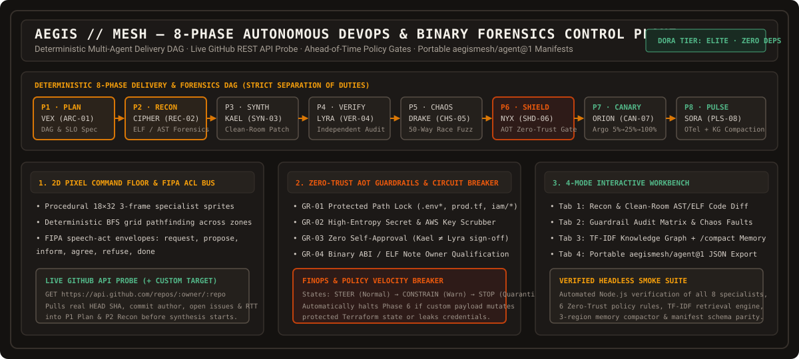

# AEGIS // MESH — Autonomous 8-Phase DevOps & Binary Forensics Control Plane

[](https://github.com/saiprasanth-git/aegismesh-control-plane/actions/workflows/ci.yml)
[](package.json)
[](engines.js)
[](LICENSE)

**AEGIS // MESH** is an interactive, zero-dependency multi-agent DevOps & Binary Forensics Control Plane simulation workbench. It models a deterministic **8-phase software delivery DAG** with strict separation of duties, a **2D pixel-art command floor** with FIPA speech-act routing, a **live GitHub REST API repository probe**, **Ahead-of-Time (AOT) Zero-Trust guardrails**, a **TF-IDF Knowledge Graph**, and portable `aegismesh/agent@1` squad manifests.

<p align="center">
  
</p>

> **Executive & Technical Architecture Playbook:** Read [`AEGISMESH_ORG_VALUE_AND_ARCHITECTURE_PLAYBOOK.md`](AEGISMESH_ORG_VALUE_AND_ARCHITECTURE_PLAYBOOK.md) for the complete system design, organizational ROI model, DORA Elite telemetry mappings, and staged enterprise adoption roadmap.

---

## Why AEGIS // MESH Exists

Most multi-agent coding tools fail in production for four structural reasons:

1. **Patching Before Forensics:** Agents guess fixes from stack traces without recovering binary/bundle ASTs, ELF crash notes, or runtime call graphs first.
2. **Self-Approval Loops:** The same agent that writes a patch marks its own work as verified, bypassing separation of duties.
3. **Post-Hoc Policy Checks:** Guardrails run *after* dangerous mutations to `.env*`, `prod.tf`, or IAM policies are already staged.
4. **Unbounded Context & Token Burn:** Multi-agent handoffs loop indefinitely without hop caps, FinOps velocity circuit breakers, or structured memory compaction.

**AEGIS // MESH** solves these failure modes in an inspectable, deterministic browser control plane where every phase transition, FIPA message envelope, policy gate, and memory compaction operation can be tested and audited live.

---

## Core Capabilities

### 1. Deterministic 8-Phase DevOps Lifecycle DAG

| Phase | Specialist | Callsign | Model Profile | Primary Responsibility & Gate |
| :--- | :--- | :--- | :--- | :--- |
| **P1 · PLAN** | `VEX` | `ARC-01` | `claude-opus-4-6` | Decomposes feature intents, live GitHub repository state, and alerts into an 8-phase DAG (`maxHops=6`). |
| **P2 · RECON** | `CIPHER` | `REC-02` | `claude-sonnet-4-6` | Pre-synthesis binary/bundle AST recovery, Linux ELF core note forensics, and IPC/OpenAPI contract extraction. |
| **P3 · SYNTH** | `KAEL` | `SYN-03` | `claude-sonnet-4-6` | Synthesizes minimal, clean-room TypeScript/C unified diffs, Terraform IaC, and Argo Rollouts manifests. |
| **P4 · VERIFY** | `LYRA` | `VER-04` | `claude-opus-4-6` | Independent AST type-safety, cyclomatic complexity, and contract parity review (**zero self-approvals**). |
| **P5 · CHAOS** | `DRAKE` | `CHS-05` | `claude-sonnet-4-6` | 50-way concurrency race fuzzing, property-based assertions, and multi-locale regression matrices. |
| **P6 · SHIELD** | `NYX` | `SHD-06` | `claude-opus-4-6` | Ahead-of-Time (AOT) Zero-Trust policy gate blocking mutations to `.env*`, `prod.tf`, and high-entropy secrets. |
| **P7 · CANARY** | `ORION` | `CAN-07` | `claude-sonnet-4-6` | Progressive Argo Rollouts (`5% → 25% → 100%`) with sub-second SLO rollback and FinOps velocity breaker. |
| **P8 · PULSE** | `SORA` | `PLS-08` | `claude-sonnet-4-6` | OpenTelemetry span correlation with DORA Elite metrics and 3-region Knowledge Graph compaction. |

### 2. Live Scenario Tester & GitHub REST API Probe (`+ Custom Target`)
- **Live Repository Telemetry:** Connects directly to `https://api.github.com/repos/<owner>/<repo>` to inspect real HEAD commit SHAs, commit authors, open issue counts, and live HTTP round-trip latency before synthesis begins.
- **Dynamic Phase 6 Quarantine:** Evaluates custom crash logs, sourceless bundle traces, and policy payloads in real time—automatically halting execution at **Phase 6 (`BREAKER: STOP`)** if protected paths (`prod.tf`, `.env`, `k8s/secrets.yaml`) or secret tokens (`AWS_SECRET_ACCESS_KEY`) are detected.

### 3. 2D Pixel-Art Command Floor & 4-Mode Engineering Workbench
- **Procedural Sprite & Pathfinding Engine (`sprites.js`):** Renders 18×28 portraits and 18×32 3-frame walking animations for all 8 specialists using a warm industrial palette, deterministic BFS tile pathfinding, and FIPA ACL speech-act envelopes (`request`, `inform`, `propose`, `agree`, `refuse`, `done`).
- **4-Mode Engineering Workbench:**
  1. **Recon & Code Diff:** Side-by-side binary/bundle forensic findings and clean-room unified diffs.
  2. **Guardrails & Chaos:** Interactive toggle matrix for all 6 Zero-Trust guardrails plus live fault injection.
  3. **KG & Memory Graph:** Searchable TF-IDF Knowledge Base, bipartite Agent-Topic graph canvas, and `/compact` 3-region context window compactor (`Pinned` / `Condensed` / `Recent`).
  4. **Squad Manifest:** One-click export of portable `aegismesh/squad@1` and `aegismesh/agent@1` JSON definitions.

---

## Included Baseline Missions

| Mission ID | Target Artifact / Domain | Forensic Root Cause & Synthesized Fix |
| :--- | :--- | :--- |
| `mission-payment-canary` | `dist/checkout-worker.bundle.js` | **42ms Webhook Race Window:** Adds Redis `NX EX 86400` idempotency locking on `X-Idempotency-Key` prior to Stripe capture. |
| `mission-elf-crash-triage` | `core.flightd.4812 (Linux ELF64)` | **Owner-Unqualified ELF Core Notes:** Qualifies `(owner, type)` namespace pairs before decoding `NT_PRPSINFO` vs `GNU_BUILD_ID`. |
| `mission-oauth-pkce` | `auth-gateway.min.js` | **Missing PKCE Verifier Enforcement:** Enforces constant-time `S256` code challenge verification and rotates refresh tokens. |
| `mission-terraform-drift` | `infra/prod.tf` & `k8s/secrets.yaml` | **Unauthorized IaC Mutation:** Demonstrates Ahead-of-Time Phase 6 policy quarantine (`BREAKER: STOP`) on protected state paths. |

---

## Quick Start & Verification

### 1. Run the Interactive Control Plane Locally

No build step or external dependencies are required:

```bash
git clone https://github.com/saiprasanth-git/aegismesh-control-plane.git
cd aegismesh-control-plane

# Serve with Python
python3 -m http.server 3000

# Or serve with Node.js
npm start
```

Open `http://localhost:3000` in your browser.

### 2. Run the Automated Headless Verification Suite

The repository includes a zero-dependency Node.js verification suite (`tests/verify-engines.mjs`) that validates the 8-agent DAG, all 6 Zero-Trust guardrails, the TF-IDF retrieval engine, the 3-region memory compactor, BFS grid pathfinding, and `aegismesh/agent@1` manifest parity:

```bash
npm test
```

```text
AEGIS // MESH — Running Headless Verification Suite...

  [PASS] 1. 8-Specialist roster maps cleanly across Phases P1..P8
  [PASS] 2. 6 Zero-Trust Ahead-of-Time (AOT) guardrails are active by default
  [PASS] 3. All 4 baseline missions contain complete 8-phase telemetry & diffs
  [PASS] 4. TF-IDF Knowledge Graph search ranks forensic & canary records accurately
  [PASS] 5. 3-Region Memory Compactor (/compact) preserves pinned invariants & condenses window
  [PASS] 6. Portable aegismesh/squad@1 & aegismesh/agent@1 manifest export passes schema check
  [PASS] 7. Deterministic BFS grid pathfinder computes contiguous routes on 2D floor
  [PASS] 8. UI & stylesheet integrity (warm muted industrial palette, zero neon glow)

OK — 8/8 verification suites passed.
```

---

## Repository Structure

```text
aegismesh-control-plane/
├── index.html                                        # Control plane UI shell, 8-phase ribbon, DORA strip & modals
├── styles.css                                        # Warm industrial dark & daylight neo-brutalist design system
├── sprites.js                                        # Procedural 18×28 portrait & 18×32 walking sprite generator + BFS
├── engines.js                                        # 8 agents, 6 guardrails, 4 missions, TF-IDF KG & memory compactor
├── app.js                                            # DAG state machine, 2D floor loop, live GitHub REST API probe
├── assets/
│   └── aegismesh-architecture-banner.svg             # High-DPI vector architecture & 8-phase lifecycle overview
├── tests/
│   └── verify-engines.mjs                            # Headless Node.js verification suite for engines & schemas
├── .github/workflows/
│   └── ci.yml                                        # GitHub Actions CI pipeline
├── AEGISMESH_ORG_VALUE_AND_ARCHITECTURE_PLAYBOOK.md  # Full organizational ROI & architecture reference
├── vercel.json                                       # Static deployment configuration
├── package.json                                      # Scripts and package metadata
└── LICENSE                                           # MIT License
```

---

## License

Released under the [MIT License](LICENSE).
